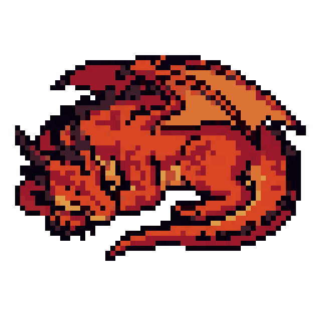
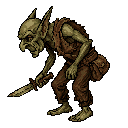
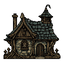
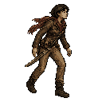

<!-- Original work Copyright 2026 Valentyn Karachevtsev (SpriteLoom)
     Licensed under the Apache License, Version 2.0
     Modifications Copyright 2026 Alessio Russo (Pixagon) -->

<p align="center"></p>

# Pixagon

**AI pixel-art assistant for [Aseprite](https://www.aseprite.org/).**
Generate sprites from a text prompt, edit an existing sprite with a plain
instruction, or redraw only a selected region. All of it runs inside
Aseprite, on your own GPU or through an optional cloud provider if you
don't have one.

**[Samples and how it works → blkdmr.github.io/pixagon](https://blkdmr.github.io/pixagon/)**

Pixagon is an Aseprite extension. You stay in the editor the whole time.
Results open in a side window, and a click drops one into your sprite as
a new layer. Pixagon never edits your existing pixels.

<p align="center">
  
  
  
  
</p>
<p align="center"><em>Made with Pixagon, one generation each.</em></p>

## What it does

- **Generate** — make a sprite from a text prompt ("wooden cottage,
  thatched roof").
- **Edit with AI** — change a sprite by instruction ("make the sword
  glow blue"). Style and everything you did not mention stays put.
- **Inpaint Selection** — the same, but it only touches the region you
  selected.
- **Rotate + Instruct** — view the same subject from another angle, for
  turnarounds.

<p align="center">
  
  
  <br><em>Rotate + Instruct: the same character from two angles.</em>
</p>

Output goes through a pixel-art postprocess step: palette quantization,
background removal, optional mirror symmetry, and fit-to-canvas, so
results land clean at your sprite size.

## Two ways to run it

Pick one in Setup. You can change it later.

### Local GPU (private, free to run)

Pixagon runs the [FLUX.2 Klein 4B](https://huggingface.co/black-forest-labs/FLUX.2-klein-4B)
diffusion model on your own computer. Nothing leaves your machine.

- **GPU:** NVIDIA with 12+ GB VRAM, or an Apple Silicon Mac (M1 or
  newer, macOS 14+). 8 GB NVIDIA cards work in a slower "Legacy 8 GB"
  mode.
- **RAM:** 16 GB minimum. On a Mac, 24 GB or more of unified memory is
  recommended.
- **Disk:** about 15 GB for the model, downloaded by Setup.

### OpenRouter (cloud, no GPU needed)

No NVIDIA GPU, no Apple Silicon Mac, or a card that is too weak? Use an
[OpenRouter](https://openrouter.ai) image model instead. There is no
15 GB download. Paste your OpenRouter API key into Setup and go. The
default model is `google/gemini-2.5-flash-image`, and you can type any
OpenRouter model that returns images. Things to know:

- Requests are billed to your own OpenRouter account.
- Your prompts, and the sprite and selection you edit, are sent to
  OpenRouter and the model's provider.
- Cloud models are slower per picture and follow the seed less closely.
- Results still go through the same pixel-art cleanup as local ones.

There is no CPU fallback for the local model, and AMD cards and Intel
Macs are not supported locally. OpenRouter works on any machine that
runs Aseprite.

**Both providers** need Aseprite 1.3 or newer, on Windows, Linux (NVIDIA
driver with CUDA 12.8 for local) or macOS.

## Install

1. Download the `.aseprite-extension` file and double-click it, or use
   **Edit → Preferences → Extensions → Add Extension** in Aseprite.
2. Open the Pixagon panel. Setup opens by itself if something is
   missing. You can also open it from the **Pixagon Setup...** command
   or the **Setup...** button on the panel.
3. Pick a provider: **Local GPU** or **OpenRouter** (type your API key
   and press **Save OpenRouter settings**). Press **Install**. It
   installs [uv](https://docs.astral.sh/uv/) and a Python environment,
   plus the 15 GB model for Local GPU only. You do not need Python
   installed first.
4. The panel starts the server for you once everything is installed.
   Type a prompt and generate.

One file works on every OS. Everything Pixagon downloads lives in a
per-user folder (`%APPDATA%\Pixagon`, `~/Library/Application
Support/Pixagon` or `~/.config/pixagon`), not inside the extension, so
updating the extension never wipes your model.

Pixagon is free, or pay what you want. The source stays open if you
prefer to [build it yourself](#building-the-extension).

## Status

The single-file extension is new. It has been run end to end on Linux
with the OpenRouter provider. The local model on Windows and macOS still
needs more real-hardware testing. If something misbehaves, please
[open an issue](https://github.com/blkdmr/pixagon/issues).

## Open source and licenses

[Apache 2.0](LICENSE).

Pixagon is open source and is a derivative work of
[SpriteLoom](https://github.com/vkarach/spriteloom) by Valentyn
Karachevtsev, licensed under Apache 2.0. See
[THIRD_PARTY_NOTICES.md](THIRD_PARTY_NOTICES.md) for details.

The FLUX.2 Klein 4B model is licensed separately by Black Forest Labs
under Apache 2.0 and downloaded at runtime, not redistributed here.

**[Source, samples and docs → blkdmr.github.io/pixagon](https://blkdmr.github.io/pixagon/)**

## Development

### From a clone

Link `plugin/` into Aseprite's extensions folder as `pixagon`:

```
ln -s "$PWD/plugin" ~/.config/aseprite/extensions/pixagon         # Linux
ln -s "$PWD/plugin" ~/Library/Application\ Support/Aseprite/extensions/pixagon   # macOS
mklink /D "%APPDATA%\Aseprite\extensions\pixagon" "%CD%\plugin"   # Windows (cmd)
```

Restarting Aseprite picks up every change without rebuilding.

To run the server by hand: stop it in the panel, then from the data
folder: `PYTHONPATH=<clone> .venv/bin/python -m server.main`.

### Tests

**Server + helper** (CI runs on Windows, macOS and Linux):

```
.venv/bin/python -m pytest server/tests/ launcher/tests/ --ignore=server/tests/smoke.py -q
```

**Plugin** (Lua 5.4):

```
luacheck plugin/*.lua plugin/tests/*.lua
lua plugin/tests/test_prompt.lua
lua plugin/tests/test_panel.lua
lua plugin/tests/test_bootstrap.lua
lua plugin/tests/test_control.lua
```

**Smoke test** (needs GPU + model):

```
.venv/bin/python -m server.tests.smoke "demonic sword" --size 64
```

### Building the extension

```
release/build.sh
```

Writes `release/dist/pixagon-<version>.aseprite-extension`. Nothing is
compiled; builds on any OS. CI builds on every push.

### Releasing

1. Copy `release/.env.example` to `release/.env` and add your itch.io key.
2. Bump `version` in `plugin/package.json` and `VERSION` in
   `launcher/version.py` (a test checks they match), and update
   `CHANGELOG.md`.
3. `release/build.sh`, then `release/publish.sh`.

## Troubleshooting

Read `daemon.log` in the data folder if Setup or the panel seems stuck.

If the server crashes or never finishes loading, run the diagnostic from
the data folder (with `PYTHONPATH` set to the extension or clone folder):

```
.venv/bin/python -m server.diagnose
```

It prints package versions, memory headroom, GPU info, and model file
integrity, then loads the transformer on its own.
